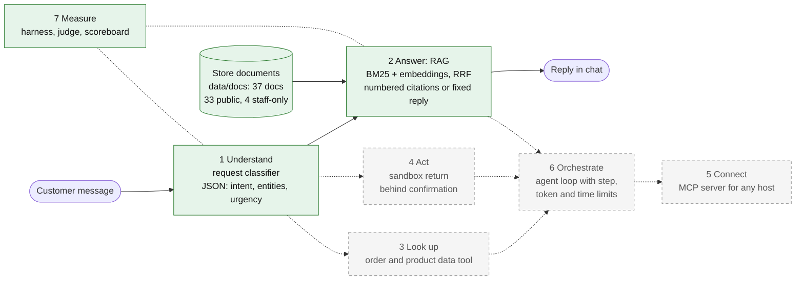

# Architecture

Owner: Nurettin Selim Özyılmaz (agent and tools lead). State on 23 Nov 2026, week 3. Answers the week 2 feedback "show the architecture".

The handbook gives every team the same seven layers (section 2). Solid boxes are built and measured. Dashed boxes are planned.

## Layers

| Layer | What it does | State | Code | Measured by |
|---|---|---|---|---|
| 1 Understand | Classifies each message into JSON: intent (5 UC1 intents), order IDs and product codes, urgency. Temperature 0, schema validation, retries, fails closed | Built in week 2 | `src/week2.py` (`classify`), improvements in PR #4 | Exact match 36–37 of 40 per run (week 2) |
| 2 Answer (RAG) | Finds the store passages for the message and answers only from them, citing each fact as [n]. Says a fixed sentence when the documents do not have the answer | Built in week 3, no reranker yet | `src/corpus.py`, `src/retrieval.py`, `src/rag_answer.py`, `prompts/rag_v1.txt` | Week 3 retrieval test set (W3.5) and faithfulness (W3.6), in progress |
| 3 Look up | Queries orders, products and shipments, the counts and current values no document contains | Week 4 | — | `task_success` |
| 4 Act | Starts a return in a sandbox, only after the customer confirms | Weeks 4–5 | — | `task_success`, `injection_success` |
| 5 Connect | Exposes the tools as an MCP server | Week 5 | — | demo in a standard MCP host |
| 6 Orchestrate | Runs multi-step tasks with step, token and time limits | Weeks 4 and 6 | — | steps per task, `pass_k` |
| 7 Measure | Runs every test case, judges answers, writes the scoreboard | Built in week 2 | `src/evaluate_week2.py`, `src/rescore_week2.py`, `src/evaluate_abstention.py` | the scoreboard itself |

## How one message flows today

1. The classifier reads the message and returns its intent, codes and urgency.
2. Hybrid search ranks the 108 public chunks twice, with BM25 (word overlap, keeps codes like `TR-220` whole) and with embeddings (meaning), and fuses the two rankings with reciprocal rank fusion.
3. The top 5 chunks are numbered and sent with the message to `openai/gpt-oss-20b`. The answer must cite them, or use the fixed reply.
4. `check_citations()` confirms that every cited number exists, and flags answers without citations.

Run it: `python src/demo.py` (live demo, needs `GROQ_API_KEY`) or `python src/demo.py --no-llm "…"` (retrieval only).

## Design choices

- **Access control at retrieval time.** Staff-only documents (refund exceptions, fraud signals) are never indexed for the customer assistant, so no prompt injection can make it quote them.
- **Structure-aware chunks.** One chunk per section of a document, with the title and heading on top, so a citation points to one rule.
- **Hybrid search.** Embeddings match meaning ("money back" to "refund", cosine 0.76), but they place different product codes close together ("TR-220" to "TR-310", 0.77). BM25 keeps exact codes apart. See `src/embedding_map.py`.
- **Untrusted text stays in the user role.** Customer messages and passages are data. Only the prompt files are system instructions.
